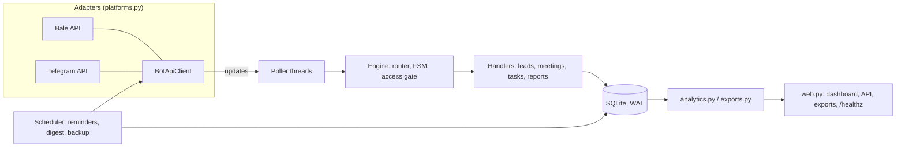

# SalesDesk

A sales CRM that lives in the messenger your team already uses. Salespeople log customers, calls,
meetings and tasks from **Bale** or **Telegram** in a few taps; the CEO gets a live management
dashboard, Excel exports and automatic reminders. One codebase, both platforms, no paid APIs.

## Features

| Who | What |
|-----|------|
| Employee | Add, **edit and delete** customers; **search** by name, company or phone; **filter** by stage and by owner; paginated lists |
| Employee | Log calls, move a customer through the pipeline (new, contacted, meeting, proposal, won, lost) |
| Employee | Book a meeting with buttons only, **reschedule** or **cancel** it; **automatic reminder** before it starts |
| Employee | Daily to-do list (`/tasks`) with due dates picked by button or typed as a Jalali date |
| Employee | **Excel / CSV export** of their own customers |
| Manager | Dashboard: KPIs, funnel, team performance for today / 7 / 30 / 90 days with period-over-period change, per-employee table |
| Manager | Full export (customers and meetings sheets), morning digest, opens as a **Mini App** inside Bale or Telegram |
| Ops | Persistent conversation state, daily SQLite backups, health probe, Docker, structured logs, CI |

## Customer profile and activity (CRM)

Open any customer from `/leads` (or search) to get its profile: contact details, **acquisition source**, sales stage, owner, next follow-up (flagged when overdue), last activity, counters and the latest activity. From the profile:

| Action | What it does |
|---|---|
| 📞 Log contact | Outcome (answered, no answer, wrong number, callback requested, interested, not interested), notes, optional duration, optional next follow-up date. Every contact is a new record; earlier ones are never overwritten. Reaching the customer moves a *new* lead to *contacted* |
| 📜 History | One chronological timeline of contacts, meetings, notes and **every stage change** (previous stage, new stage, who, when), plus separate contact and meeting history pages |
| 📝 Notes | Add, edit and delete notes per customer (soft delete: deleted notes leave the profile and timeline) |
| 📅 Meetings | Book, reschedule, cancel; record the outcome **held** or **not held** with a note and a next follow-up date. `/meetings` lists meetings whose time has passed and still await an outcome |
| 🔄 Stage | Move through new, contacted, meeting, proposal, won, lost; automatic moves (first real contact, first meeting) are recorded too and never move a customer backwards |

Tasks (`/tasks`, `/task`) have **priorities** (high, medium, low), due dates picked by button or typed in Jalali, **edit**, **delete** (soft), complete and reopen, and list views: today, open, overdue, done.

Business rules live in `db.py` (transactional operations) and `crm.py` (profile assembly); `bot/texts.py` formats, `bot/handlers/` only converse. Conversation steps shared by several flows (the follow-up picker) are written once in `handlers/followup.py`, and registering the same command or callback twice is now an error instead of a silent override.

## Architecture



Ports and adapters: everything above `Engine` is platform-agnostic and talks to a small `Messenger`
protocol. Telegram and Bale share one Bot API client; the only differences are the base URL and
network tuning (Bale forces IPv4 and HTTP/1.1, as recommended for Iranian networks).

```
src/salesdesk/
├── __main__.py        composition root (wires everything, graceful shutdown)
├── config.py          typed settings, production validation
├── domain.py          pure dataclasses and constants
├── db.py              SQLite repository, versioned migrations, soft delete
├── platforms.py       Messenger protocol, update parsing, hardened Bot API client
├── bot/
│   ├── engine.py      router, persistent FSM, invite-code gate, polling loop
│   ├── handlers/      leads, meetings, tasks, reports (one module per area)
│   ├── texts.py       all copy (plain text: renders identically everywhere)
│   ├── keyboards.py   inline / reply keyboard builders
│   └── views.py       message builders shared with the scheduler
├── scheduler.py       reminders, digest, backups (idempotent, restart-safe)
├── analytics.py       summary and period comparison, derived from the event log
├── exports.py         CSV and a dependency-free RTL xlsx writer
├── web.py             stdlib HTTP server
└── seed.py            demo data
dashboard/index.html   single-file responsive UI (Persian, RTL, dark mode aware)
```

Design decisions worth knowing:

- **Event log as the source of truth for metrics.** Every action appends to `events`; any range or comparison is a query on it, so a new metric needs no schema change. Deleting a lead removes its events from the numbers.
- **Conversation state lives in the database**, so a restart or deploy never strands a user mid-flow.
- **Soft delete** keeps history consistent and cancels the lead's upcoming meetings.
- **Idempotent jobs**: a reminder is marked sent only after delivery succeeds (failures retry on the next tick); the digest and backup are claimed per day in a key-value table.
- **Authorisation is checked server-side on every callback**, not just by hiding buttons: only the owner or a manager can edit, delete, change stage or reschedule.
- **Plain-text messages** avoid HTML/Markdown differences between platforms.
- **No token leaks**: client errors never include the request URL, and `httpx` request logging is silenced.

## Quick start

```bash
git clone <repo-url> && cd salesdesk
python -m venv .venv && source .venv/bin/activate
make install
cp .env.example .env     # fill in the tokens (see below)
make run
```

**Demo without any token or `.env`:** `make demo` creates `data/demo.db` with fake data and serves it at http://127.0.0.1:8080. It never touches your real database (the seed command refuses to overwrite a database that holds real customers).

### Create the bot

1. **Bale:** open `@botfather` inside Bale, create a bot, put the token in `BALE_BOT_TOKEN`.
   **Telegram:** same with `@BotFather` into `TELEGRAM_BOT_TOKEN`. You can run both at once.
2. Send `/id` to your bot. It answers with something like `bale:123456789`. Put the managers' values in `CEO_IDS`.
3. Choose a `TEAM_CODE` and share it with employees; they send it once to unlock the bot.

## Using it

| Command / menu | Action |
|---|---|
| 👥 `/leads` | List with stage filters, "mine only" toggle and paging; open a card to edit, delete, call, book, change stage |
| 🔎 `/search` | Search name, company or phone (Persian digits work) |
| 👤 `/new` | Add a customer |
| 📞 `/call` · 🔄 `/stage` | Log a call · change a customer's stage |
| 📅 `/meetings` · `/meeting` | Manage upcoming meetings · book a new one |
| 📋 `/tasks` · ➕ `/task` | Today's tasks (tap to complete) · add a task |
| 📤 `/export` | Excel or CSV |
| 📊 `/dashboard` | Manager only: dashboard link or Mini App button |
| `/today` · `/stale` · `/cancel` · `/id` | Today's meetings · neglected customers · abort a flow · show your id |

## Configuration

See `.env.example` for every variable. In `APP_ENV=production` the app refuses to start without
`CEO_IDS`, `TEAM_CODE` and a `DASHBOARD_KEY` of at least 16 characters.

## Deployment

```bash
cp .env.example .env && nano .env
docker compose up -d --build                 # bot + dashboard on 127.0.0.1:8080
docker compose --profile https up -d         # optional: Caddy with automatic HTTPS (edit deploy/Caddyfile)
```

Without Docker, use `deploy/salesdesk.service` (systemd). Operations:

- **Health:** `GET /healthz` (no key). The container healthcheck uses it.
- **Backups:** a consistent SQLite snapshot is written daily to `BACKUP_DIR` and pruned to `BACKUP_KEEP`. Copy that folder off the server.
- **Upgrades:** schema changes ship as numbered migrations in `db.py`; they run automatically on start.
- **Network:** polling needs outbound HTTPS to `tapi.bale.ai` and/or `api.telegram.org`. Telegram is filtered in Iran, so a server there needs a proxy or should run Bale only.
- **Scale:** one process is enough for a team of dozens. SQLite in WAL mode handles it; run a single instance only.

## Development and production modes

`APP_ENV=development` (default) needs only a bot token. `APP_ENV=production` additionally requires
`CEO_IDS`, `TEAM_CODE` and a `DASHBOARD_KEY` of 16+ characters, but only when the real bot starts:
`make demo`, `salesdesk-admin` and `python -m salesdesk.web` never demand secrets. Invalid values
(`DIGEST_HOUR=abc`, an unknown `TIMEZONE`, ...) stop start-up with a message naming the variable.

## Reliability model

- **Delivery:** reminders and the morning digest follow *claim, send, release on failure*. The claim is an atomic database write, so two ticks or two processes can never both deliver the same notification; a failed send is retried with backoff (1, 2, 4 ... minutes, at most 8 attempts). Permanent errors (HTTP 400/401/403/404, e.g. a user blocked the bot) are not retried. A crash between claim and send can lose one notification but never duplicates it.
- **Isolation:** every scheduler job, update and HTTP request is handled in its own error boundary with a logged traceback; one failure never stops the others.
- **Digest timing:** sent to each user once per local day, from `DIGEST_HOUR` on (a bot that was down at 08:00 sends it when it comes back up the same day).
- **Time zones:** all times are stored in UTC and shown in `TIMEZONE` (default Asia/Tehran, a fixed UTC+03:30 since Iran abolished daylight saving time in 2022).
- **Reminders** go only to the owner of a *scheduled* meeting: cancelled, completed, no-show and rescheduled meetings never trigger one.

## Backup and restore

A verified snapshot is written daily to `BACKUP_DIR` (kept: `BACKUP_KEEP`). Snapshots are single self-contained files, written atomically and checked with `PRAGMA integrity_check` before they are published.

```bash
python -m salesdesk.admin backup                  # snapshot now (or --to FILE)
python -m salesdesk.admin verify data/backups/salesdesk-2026-11-01.db
# stop the bot, then:
python -m salesdesk.admin restore data/backups/salesdesk-2026-11-01.db --yes
```

`restore` validates the file first (corrupt, foreign or newer-schema files are refused before anything changes), keeps the current database as `*.before-restore-<time>`, and migrates an older snapshot automatically.

## Upgrading existing databases

Schema changes are numbered, atomic migrations (`PRAGMA user_version`); a failing migration rolls back completely. Before upgrading a non-empty database a safety copy is written next to it (`*.pre-migration-vN.bak`; restore it with the command above to roll back). Databases from the pre-1.0 Telegram-only releases are detected and converted, with Telegram ids mapped to the new user table.

## Exports

`/export` and the dashboard buttons give **xlsx** (RTL sheets, frozen bold header, filter, text cells so phone numbers keep their leading zero) and **CSV** (UTF-8 with BOM, formulas neutralised). Excel converts digit-only CSV fields to numbers and drops a leading zero when a CSV is opened by double-click; use the xlsx export (or Data > From Text) when that matters.

## Development

```bash
make test   # pytest: flows are driven end to end through a fake messenger
make lint   # ruff
```

## Known limitations and roadmap

- Long polling only (no webhook mode yet). Run exactly one instance per bot token.
- Mini App authentication uses the dashboard key in the URL; verifying Bale `initData` signatures is a planned hardening step.
- Not yet: per-lead notes history, reassigning a customer to another employee, user deactivation command.
